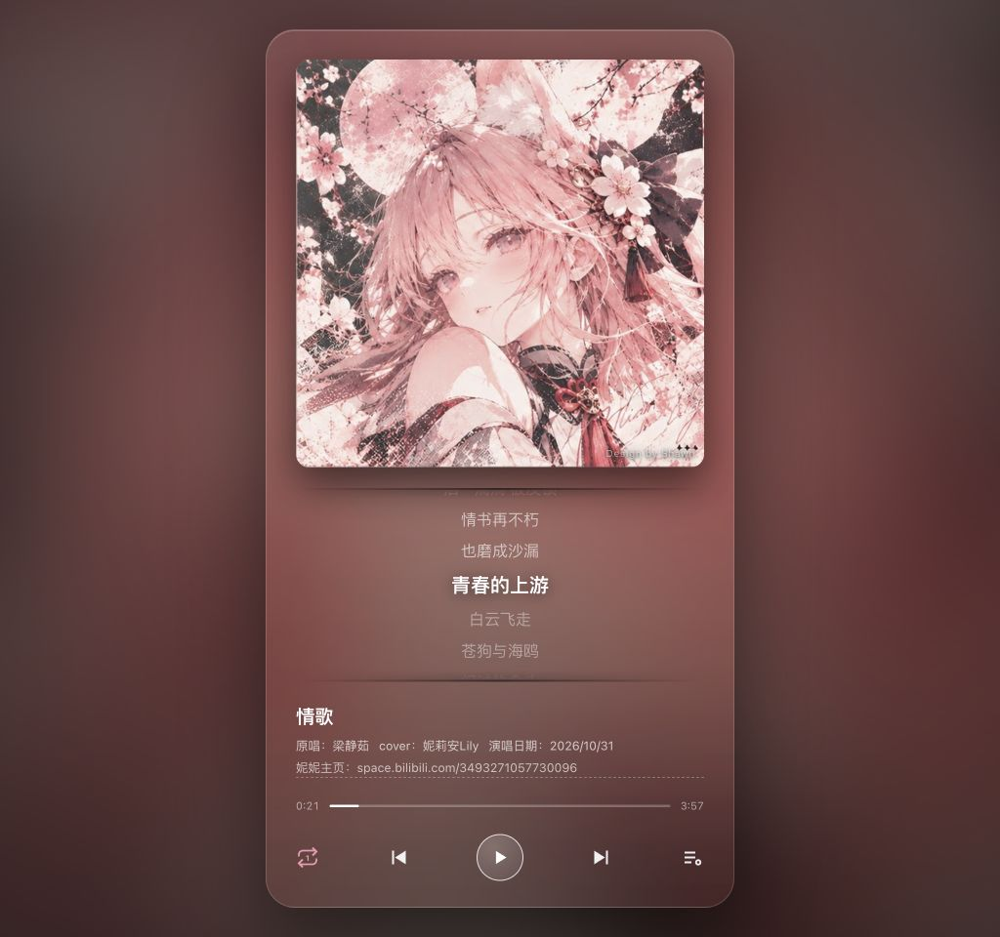
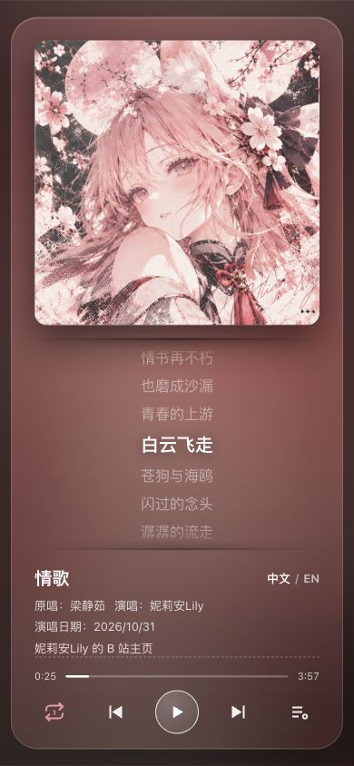
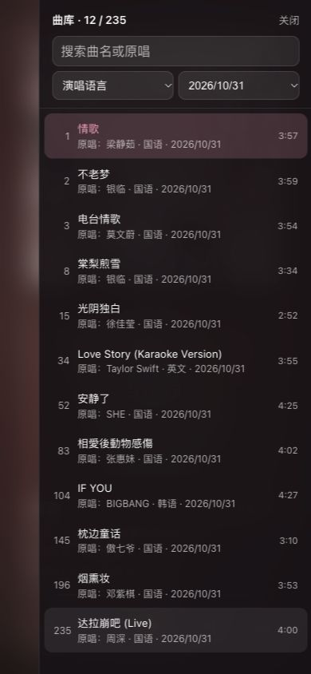
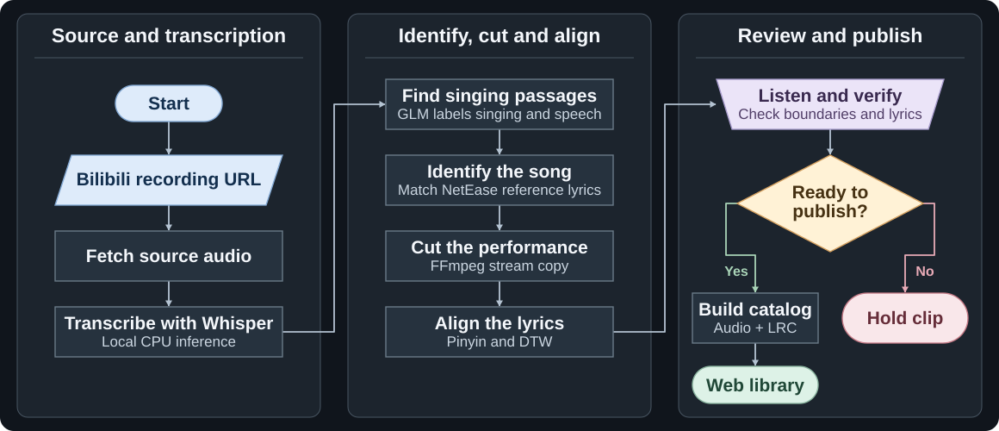

# VTuber Auto Song Clipper｜VTuber 录播歌切工作流

**English** · [简体中文](README.zh-CN.md)

Submit a recording URL to extract performances, identify the songs, align their lyrics, and review the results. Approved performances can then be published to a web song library.

[Case study](#case-study) · [Workflow](#workflow) · [Quick start](#quick-start) · [Technology](#technology) · [Quality requirements](#quality-requirements) · [Development log](#development-log)

**Project status:** The project has concluded. The live catalog retains the 235 tracks from the V1 clipping workflow. V2 clipping is documented as a historical trial. [V2 trial and rollback retrospective](docs/项目复盘.md#english)

## Case study

- **VTuber**: 妮莉安Lily
- **VTuber profile**: [妮莉安Lily on Bilibili](https://space.bilibili.com/3493271057730096?spm_id_from=333.337.0.0)
- **Recording platform**: [Bilibili singing stream archive, November 26, 2023](https://www.bilibili.com/video/BV1ej411L7qb/) (example from the processing log)
- **Live player**: [Open the 妮莉安Lily song library](http://101.43.7.149:18081/web/)

The screenshots were captured on November 13, 2026 from the updated player running locally with the case-study library. The desktop layout pairs a rotating record with synchronized lyrics. Both layouts offer a Chinese and English interface.

> **Copyright and takedown.** The recordings, performances, lyrics, cover artwork, and character imagery shown in this case study belong to their respective rights holders. The screenshots illustrate the project. If you believe any displayed material infringes your rights, contact the maintainer with a link, the material at issue, and a description of your rights. The maintainer will review removal or correction requests. Keep personal information and proof of ownership out of public issues. [Contact the maintainer](https://github.com/Killer-Anya/AutoSongClip/issues/new)

<table>
  <tr>
    <td align="center" valign="top"></td>
    <td align="center" valign="top"></td>
    <td align="center" valign="top"></td>
  </tr>
  <tr>
    <td align="center">Desktop player</td>
    <td align="center">Mobile player</td>
    <td align="center">Mobile library</td>
  </tr>
</table>

## Workflow

[Deployed V1 architecture](docs/V1-技术方案.md#english) · [V1 listening checks](docs/质量要求.md#english) · [V2 experiment and measurements](docs/指标与质量报告.md#english-summary)

## Quick start

### Download, extract, and double-click to preview

1. [Download the ZIP](https://github.com/Killer-Anya/AutoSongClip/archive/refs/heads/main.zip) and extract the whole folder.
2. Install [Python 3.10 or later](https://www.python.org/downloads/). On macOS, double-click `Start SongCut.command`. On Windows, double-click `Start SongCut.bat`.
3. Keep the launcher window open while using the player. The preview only needs Python and starts with an empty library. To load your own tracks, follow the [player notes](site/README.md).

On Linux, run `python3 site/server.py 18081 --open` in the extracted folder. If port 18081 is in use, choose another port in that command.

### Running the clipping workflow

The launchers open the player. The [V1 architecture](docs/V1-技术方案.md#english) describes how the live recordings were produced. The runnable batch commands in this repository are documented separately in [Reproducing the V2 experiment](docs/V2-复现说明.md#english), together with the tested server configuration.

## Technology

| V1 stage | Implementation |
| --- | --- |
| Audio source and cutting | Bilibili source audio and FFmpeg stream copy. Each published clip is a continuous performance. |
| Transcription and segmentation | Local Whisper timestamps and GLM text classification help locate the singing. |
| Song identification and lyrics | NetEase Cloud Music supplies song candidates and reference lyrics. The workflow aligns the reference lyrics to the performance using the transcript. |
| Release | Manual listening and catalog review precede publication to the web player. The deployed V1 workflow ran without MiMo. |
| Playback | HTML, CSS, JavaScript, and `HTMLAudioElement`. The bundled Python preview supports byte-range requests for seeking. |

The public `pipeline/`, `lib/`, and `tools/` describe the V2 implementation and supporting tools. The public `site/` contains the player preview.

## Quality requirements

V1 prioritizes the continuous sung performance. Some cuts leave out part of the instrumental intro or the final decay. Review the beginning and end by ear alongside the original recording, and check the song identity and lyric timing. The quality notes list V1’s checks alongside the thresholds and measurements from the V2 trial. [V1 review checklist and V2 quality references](docs/质量要求.md#english)

## Development log

The [development log](docs/开发日志.md#english) records V1 deployment, V2 stage validation, model comparisons, recovery from service errors, and checks run on the public code. [Sanitized log samples](logs/) show stage output and failure reasons.

## Contributing and license

When reporting a problem, include the version, steps to reproduce, and expected and observed results. Changes to cut points or lyric timing should include sample details, before-and-after measurements, and listening results. Remove credentials, private recordings, and full lyrics before sharing logs or test data. [Contribution guide](CONTRIBUTING.md#english)

The project code is released under the **MIT License**. Preserve the copyright and permission notice when redistributing the code or substantial portions of it. The case study's recordings, songs, lyrics, artwork, and character imagery retain their respective rights. [Full license](LICENSE)
