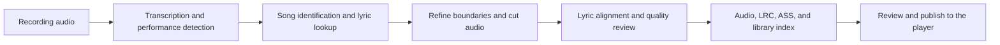

# SongCut

**English** · [简体中文](README.zh-CN.md)

Extract song performances from long Bilibili livestream recordings, identify tracks, align lyrics, and review the results before publishing them to a browsable web library.

[Preview](#preview) · [Quick start](#quick-start) · [Workflow](#workflow) · [Quality and logs](#quality-and-logs)

## Preview

These screenshots were captured from the deployed V1 player on November 10, 2026. This repository contains the V2 song-cutting pipeline and web player source.


*Desktop player (1024 × 960)*

<table>
  <tr>
    <td align="center" width="50%">
      
      <br /><strong>Player and synchronized lyrics</strong>
    </td>
    <td align="center" width="50%">
      
      <br /><strong>Browse performances by date</strong>
    </td>
  </tr>
</table>

Mobile captures use a 390 × 844 browser viewport.

## Workflow



- **Long recordings and multiple parts.** Transcription caches can be reused for the same recording and part, and the queue records processing progress.
- **Separate checks for cuts and lyric timing.** Silence, performance regions, and media parameters support cut review. Transcription timestamps, lyric recall, and dynamic time warping (DTW) support alignment review.
- **Traceable review results.** The performance index, quality metrics, rejection records, and sanitized logs explain what happened to a segment.
- **Web player included.** Plain HTML, CSS, and JavaScript provide library browsing, synchronized lyrics, and playback controls.

A performance that passes the processing and review stages is organized into `01_audio.m4a`, `02_lyrics.lrc`, and `03_karaoke.ass`.

## Quick start

### Preview the web player

Start the Python static server from the repository root.

```bash
python3 site/server.py 18081
```

Open `http://127.0.0.1:18081/web/`. The included player starts with an empty library so you can preview its layout and empty state. To load your own library, prepare `queue/songs_index.json` and its referenced audio, then run `python3 lib/build_site.py`. The player reads audio from `site/audio/`. The frontend layout is documented in the [player notes](site/README.md).

### Install pipeline dependencies

The pipeline is designed for Linux. Use Python 3.10 or later and install FFmpeg, FFprobe, Bash, `flock`, and `free`. Local transcription uses the faster-whisper `small` model. Place the extracted model files in `models/small` or set `SONG_CUT_MODELS` to the parent directory of `small`.

```bash
git clone https://github.com/Killer-Anya/songcut.git
cd songcut
python3 -m venv .venv
source .venv/bin/activate
python -m pip install -r requirements.txt
```

### Run a processing entry point

Replace the sample BV ID, title, date, and part number with your own recording information. Single-recording and queue modes require a reachable text review service and the credentials for that service. The default Tongji service proxy listens on local port 18090. See [llmcfg.py](lib/llmcfg.py) for text review configuration.

```bash
# Process part 1 of a recording
python3 pipeline/pipe_v3.py BV1xxxxxxxxx 'Performance title' 2026-01-01 1

# Process up to 5 entries from your queue/streams_v3.json
python3 pipeline/run_v3.py 5

# Reprocess part 1 from an existing audio track and transcription cache
python3 pipeline/pipe_offline.py BV1xxxxxxxxx 1
```

Use the [queue format (Chinese)](queue/README.md) to prepare the input file. Cached reprocessing requires `res/<recording-tag>.m4a`, `queue/asr_v3/<recording-tag>.jsonl`, and local lyric reference data. The tag is the BV ID for part 1 and `BV_ID_pN` for later parts. This mode skips cloud language-model review and may contact a lyric service for missing references.

The release was checked with a local player preview, HTTP byte ranges, and a sample catalog build. A full media run requires an actual recording, model files, and service configuration.

## Configuration

| Environment variable | Purpose and default |
| --- | --- |
| `SONG_CUT_HOME` | Working root. The main entry points default to the repository root and resolve scripts, `res/`, `queue/`, and `library/` relative to it. |
| `SONG_CUT_FFMPEG`, `SONG_CUT_FFPROBE` | Media executable overrides. The main entry points check explicit configuration, `bin2/`, and the system `PATH`, in that order. |
| `SONG_CUT_PY` | Python executable for subprocesses. Defaults to `python3`. |
| `SONG_CUT_PYTHONPATH` | Extra module search path read by the path helpers. Defaults to an empty value. |
| `SONG_CUT_MODELS` | Parent directory of the local `small` model. Defaults to `<project-root>/models`. |
| `TONGJI_API_KEY` | Credential for the Tongji service. Defaults to an empty value. Supply your own through the environment. |
| `JUDGE_API`, `JUDGE_HEALTH`, `JUDGE_KEY`, `JUDGE_MODEL` | Endpoint, health check, credential, and model overrides for text review modules. |
| `MIMO_ASR`, `MIMO_ANCHOR` | Experimental switches for MiMo transcription and timing anchors. Both default to `0`. |

## Technology and layout

Python orchestrates the pipeline. FFmpeg, FFprobe, and PyAV handle media, and faster-whisper provides local transcription. NumPy, pypinyin, zhconv, and project DTW modules support audio analysis, Chinese text normalization, and lyric alignment. Some review stages use external models.

| Directory | Contents |
| --- | --- |
| `pipeline/` | Single-recording, queue, and cached reprocessing entry points |
| `lib/` | Downloading, decoding, transcription, segmentation, song identification, alignment, quality checks, and site generation |
| `tools/` | Karaoke subtitles, final checks, independent review, reporting, and publishing |
| `site/` | Single-file web player and preview server |
| `docs/` | Architecture, stage specifications, metrics, and screenshots. Technical documents are in Chinese. |
| `queue/`, `logs/` | Sample queue and sanitized log samples |

## Quality and logs

Audio boundaries, lyric coverage, and timing errors are recorded separately. Duets, medleys, speech, and accompaniment can affect identification and alignment. Use the original audio to review difficult sections. Runtime depends on recording length, caching, model settings, hardware, and service access.

See the [architecture notes](docs/架构说明.md), [stage specifications](docs/歌切标准_V6.md), [metrics report](docs/指标与质量报告.md), and [sanitized log samples](logs/). The logs describe the specific runs they accompany.

## Contributing and license

Include the version, input conditions, expected and observed results, and sanitized logs with a proposed change. Check changes to audio cuts and lyric timing independently. Read the [contribution guidelines (Chinese)](CONTRIBUTING.md).

The code is licensed under MIT. This repository contains source, technical documentation, sanitized logs, and screenshots. Supply your own input media and model files. Third-party dependencies and media shown in screenshots carry their respective terms. See [LICENSE](LICENSE).
