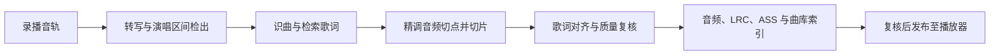

# SongCut · 歌回自动切歌流水线

**简体中文** · [English](README.md)

从 B 站歌回长录播中提取演唱片段，完成识曲、歌词对齐与质量复核，再将确认的演唱版本整理为网页曲库。

[成品展示](#成品展示) · [快速开始](#快速开始) · [处理流程](#处理流程) · [质量与日志](#质量与日志)

## 成品展示

截图采集于 2026 年 11 月 10 日，展示当时线上运行的 V1 播放器。本仓库提供 V2 切歌流水线和网页播放器源码。


*桌面播放器（1024 × 960）*

<table>
  <tr>
    <td align="center" width="50%">
      
      <br /><strong>播放器与同步歌词</strong>
    </td>
    <td align="center" width="50%">
      
      <br /><strong>按日期浏览演唱版本</strong>
    </td>
  </tr>
</table>

手机截图使用 390 × 844 的浏览器视口。

## 处理流程



- **支持长录播与分 P。** 转写缓存可按场次及分 P 复用，队列记录处理进度。
- **分别检查切点与歌词时间轴。** 静音位置、演唱区间和音频参数用于检查切片。转写时间、歌词召回和动态时间规整（DTW）用于检查歌词对齐。
- **保留复核依据。** 成品索引、质检指标、拦截记录与脱敏日志可用于追查某段演唱的处理结果。
- **附网页播放器。** 原生 HTML、CSS 和 JavaScript 提供曲库浏览、同步歌词和播放进度控制。

每段通过处理和复核的演唱对应一组输出。主要文件是 `01_audio.m4a`、`02_lyrics.lrc` 和 `03_karaoke.ass`。

## 快速开始

### 预览网页播放器

在仓库根目录启动 Python 静态服务。

```bash
python3 site/server.py 18081
```

在浏览器打开 `http://127.0.0.1:18081/web/`。仓库内的播放器以空曲库启动，供预览布局和空状态。加入自己的曲库时，准备 `queue/songs_index.json` 及其引用的音频，再运行 `python3 lib/build_site.py`。播放器从 `site/audio/` 读取音频。前端结构见 [播放器说明](site/README.md)。

### 安装流水线依赖

流水线面向 Linux 环境。建议使用 Python 3.10 或更新版本，安装 FFmpeg、FFprobe、Bash、`flock` 和 `free`。本地转写使用 faster-whisper 的 `small` 模型，将解压后的模型文件放在 `models/small`，或用 `SONG_CUT_MODELS` 指定 `small` 的上一级目录。

```bash
git clone https://github.com/Killer-Anya/songcut.git
cd songcut
python3 -m venv .venv
source .venv/bin/activate
python -m pip install -r requirements.txt
```

### 运行处理入口

用自己的录播 BV 号、场次名称、演唱日期与分 P 序号替换示例参数。单场与队列流程需要可访问的文本判断服务，并按服务配置凭据。默认的同济服务代理位于本机 18090 端口。文本判断的配置入口见 [llmcfg.py](lib/llmcfg.py)。

```bash
# 处理指定录播的第 1 P
python3 pipeline/pipe_v3.py BV1xxxxxxxxx '歌回场次标题' 2026-01-01 1

# 使用填好的 queue/streams_v3.json，最多处理 5 个队列条目
python3 pipeline/run_v3.py 5

# 使用现有音轨和转写缓存重处理第 1 P
python3 pipeline/pipe_offline.py BV1xxxxxxxxx 1
```

按 [队列格式](queue/README.md) 准备队列。缓存重处理入口需要 `res/<场次标记>.m4a`、`queue/asr_v3/<场次标记>.jsonl` 和本地歌词参考数据。第一 P 的场次标记为 BV 号，后续分 P 使用 `BV号_pN`。该模式跳过云端大模型判断，缺失歌词时可能访问歌词接口。

本次发布验证覆盖本地播放器、HTTP 字节范围响应及样例索引构建。完整媒体处理需要实际录播、模型和服务环境。

## 配置

| 环境变量 | 用途与默认值 |
| --- | --- |
| `SONG_CUT_HOME` | 工作根目录。主要入口默认使用仓库根目录，脚本、`res/`、`queue/` 和 `library/` 均相对此目录定位。 |
| `SONG_CUT_FFMPEG`、`SONG_CUT_FFPROBE` | 指定媒体工具路径。主要入口依次查找显式配置、`bin2/` 和系统 `PATH`。 |
| `SONG_CUT_PY` | 子流程 Python 解释器，默认 `python3`。 |
| `SONG_CUT_PYTHONPATH` | 路径工具读取的子流程模块搜索路径，默认空。 |
| `SONG_CUT_MODELS` | 本地 `small` 模型的上一级目录，默认 `<项目根目录>/models`。 |
| `TONGJI_API_KEY` | 同济服务凭据，默认空。通过环境变量注入自己的配置。 |
| `JUDGE_API`、`JUDGE_HEALTH`、`JUDGE_KEY`、`JUDGE_MODEL` | 文本判断模块的接口、健康检查、凭据和模型覆盖项。 |
| `MIMO_ASR`、`MIMO_ANCHOR` | MiMo 转写与时间锚点实验开关，默认 `0`。 |

## 技术栈与目录

Python 负责流程编排，FFmpeg、FFprobe 和 PyAV 处理媒体，faster-whisper 提供本地转写。NumPy、pypinyin、zhconv 和项目内 DTW 模块参与音频特征处理、中文文本规范化与歌词对齐。部分复核步骤通过外部模型完成。

| 目录 | 内容 |
| --- | --- |
| `pipeline/` | 单场、队列与缓存重处理入口 |
| `lib/` | 下载、解码、转写、分区、识曲、对齐、质检与建站模块 |
| `tools/` | 卡拉 OK 字幕、终检、独立复核、报告与发布工具 |
| `site/` | 单文件网页播放器和预览服务 |
| `docs/` | 中文架构、分阶段规范、指标报告与成品截图 |
| `queue/`、`logs/` | 队列样例与脱敏日志样本 |

## 质量与日志

片段完整性、歌词覆盖和时间偏差分别记录。合唱、连唱、杂谈和伴奏可能影响识曲与对齐，遇到这些场景可回到原始音频复核。运行时间受场次长度、缓存、模型、硬件及外部服务影响。

查看 [架构说明](docs/架构说明.md)、[分阶段标准](docs/歌切标准_V6.md)、[指标与质量报告](docs/指标与质量报告.md) 和 [脱敏日志样本](logs/)。日志对应所示的样本场次。

## 贡献与许可

提交改进时请附上版本、输入条件、预期结果、实际结果及脱敏日志。改动切点或歌词轴时分别复核对应结果。详见 [贡献说明](CONTRIBUTING.md)。

代码采用 MIT 许可证。仓库包含源码、技术文档、脱敏日志与效果图，运行媒体与模型由使用者自行准备。第三方依赖和截图中的媒体内容各自遵循对应许可。详见 [LICENSE](LICENSE)。
