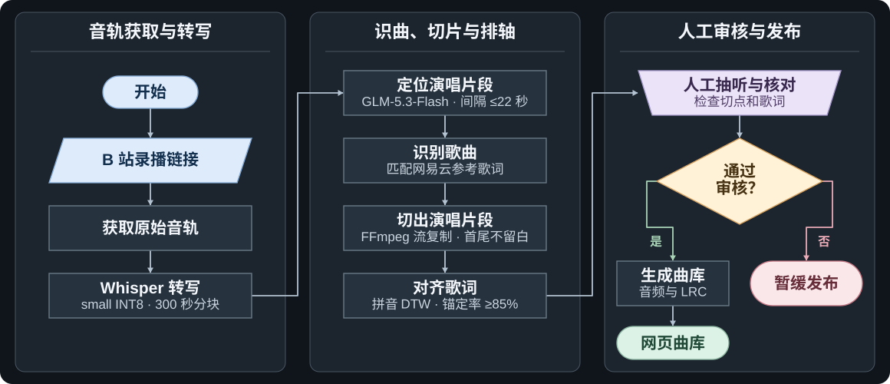

# VTuber Auto Song Clipper｜VTuber 录播歌切工作流

[English](README.md) · **简体中文**

上传一段网址，自动从录播中提取演唱片段；完成识曲、歌词对齐与质量复核，再将确认的演唱版本整理为网页曲库。

[项目案例](#项目案例) · [处理流程](#处理流程) · [快速开始](#快速开始) · [技术栈](#技术栈) · [质量要求](#质量要求) · [开发日志](#开发日志)

**项目状态**：项目已结束。线上保留 V1 歌切流程产出的 235 首曲目，V2 歌切流程留作历史实验。[V2 试运行与回退复盘](docs/项目复盘.md#简体中文)

## 项目案例

- **VTuber**：妮莉安Lily
- **VTuber 主页**：[妮莉安Lily 的 B 站主页](https://space.bilibili.com/3493271057730096?spm_id_from=333.337.0.0)
- **录播平台（B 站）**：[2023 年 11 月 26 日掉落歌回](https://www.bilibili.com/video/BV1ej411L7qb/)（处理日志中的录播样例）
- **成品在线预览**：[打开妮莉安Lily歌回曲库](http://101.43.7.149:18081/web/)

截图采集于 2026 年 11 月 13 日，展示本地运行的新版播放器和案例曲库。桌面采用黑胶封面与同步歌词的双栏布局，手机和桌面均支持中英文切换。

> **版权与下架**。案例中的录播、演唱音频、歌词、封面和角色形象等内容，其权利归各自权利人所有。案例截图用于说明项目功能。如您是权利人，认为展示内容侵犯了您的权益，请联系维护者，提供内容链接、涉及素材和权利说明。维护者将核实并处理下架或更正请求。请勿在公开 Issue 中提交个人信息或权属文件。[联系维护者](https://github.com/Killer-Anya/AutoSongClip/issues/new)

<table>
  <tr>
    <td align="center" valign="top"></td>
    <td align="center" valign="top"></td>
    <td align="center" valign="top"></td>
  </tr>
  <tr>
    <td align="center">桌面播放器</td>
    <td align="center">手机播放器</td>
    <td align="center">手机曲库</td>
  </tr>
</table>

## 处理流程

[线上 V1 技术方案](docs/V1-技术方案.md) · [V1 听审要点](docs/质量要求.md) · [V2 实验指标](docs/指标与质量报告.md)

## 快速开始

### 下载、解压、双击预览

1. 打开 [下载 ZIP](https://github.com/Killer-Anya/AutoSongClip/archive/refs/heads/main.zip)，解压整个文件夹。
2. 安装 [Python 3.10 或以上](https://www.python.org/downloads/)。macOS 双击 `Start SongCut.command`，Windows 双击 `Start SongCut.bat`。
3. 启动器会打开本地播放器。使用期间保留启动窗口。预览只需要 Python，初始曲库为空。用已有曲库预览时，按[播放器说明](site/README.md)放入索引和音频。

Linux 可在解压后的目录运行 `python3 site/server.py 18081 --open`。如果 18081 已占用，可在这条命令里改用其他端口。

### 处理自己的录播

双击启动器可打开播放器。[V1 技术方案](docs/V1-技术方案.md)说明线上曲库是怎么做出来的。仓库中可运行的批处理命令、模型配置和服务器实测环境单列在 [V2 实验复现说明](docs/V2-复现说明.md)。

## 技术栈

| V1 环节 | 实现方式 |
| --- | --- |
| 音源与切片 | 获取 B 站原始音轨，使用 FFmpeg 流复制，保留连续的演唱片段。 |
| 转写与分段 | 本地 Whisper 生成时间戳，GLM 根据文本区分演唱与说话等内容，帮助定位演唱。 |
| 识曲与歌词 | 网易云音乐提供候选歌名与参考歌词，以本地转写为参照同步歌词。 |
| 审核与发布 | 人工抽听、核对曲目后发布到网页曲库。线上 V1 没有用 MiMo。 |
| 网页播放 | HTML、CSS、JavaScript 和 `HTMLAudioElement`。随包提供的 Python 预览支持字节范围请求，可拖动播放进度。 |

公开的 `pipeline/`、`lib/`、`tools/` 包含 V2 实现与配套工具，`site/` 提供播放器预览。

## 质量要求

V1 优先保留连贯的演唱主体，少数片段的前奏或尾音略短。审核时对照原录播抽听首尾，确认歌名和歌词时间轴。仓库中的量化门槛和统计数据属于 V2 实验。[V1 听审清单与 V2 质量参考](docs/质量要求.md)

## 开发日志

[开发日志](docs/开发日志.md#简体中文) 按日期记录 V1 上线、V2 分阶段验收、模型对照实验、服务异常后的处理方式和公开版验证。仓库另附[脱敏运行样本](logs/)，便于定位实际执行阶段和失败原因。

## 贡献与许可

提交问题请附版本、操作步骤、预期与实际结果。切点或排轴改动请附所用样本、修改前后的指标与人工抽听结果。提交前请清理密钥、私人录播和完整歌词数据。[贡献指南](CONTRIBUTING.md)

项目代码采用 **MIT 许可证**。再分发代码或其主要部分时，请保留版权和许可声明。案例的录播、歌曲、歌词、封面及角色形象适用各自权利条款。[许可证全文](LICENSE)
