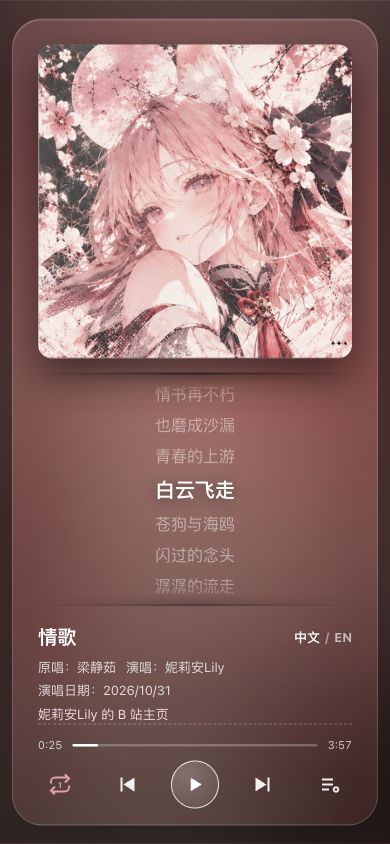
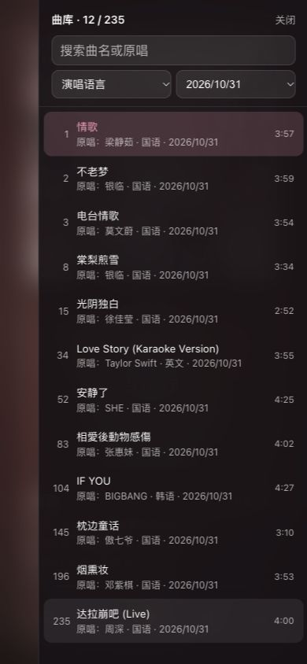

# VTuber Auto Song Clipper｜VTuber 录播歌切工作流

[English](README.md) · **简体中文**

上传一段网址，自动从录播中提取演唱片段；完成识曲、歌词对齐与质量复核，再将确认的演唱版本整理为网页曲库。

[项目案例](#项目案例) · [处理流程](#处理流程) · [快速开始](#快速开始) · [技术栈](#技术栈) · [质量要求](#质量要求) · [开发日志](#开发日志)

## 项目案例

- **VTuber**：妮莉安Lily
- **VTuber 主页**：[妮莉安Lily 的 B 站主页](https://space.bilibili.com/3493271057730096?spm_id_from=333.337.0.0)
- **录播平台（B 站）**：[2023 年 11 月 26 日掉落歌回](https://www.bilibili.com/video/BV1ej411L7qb/)（处理日志中的录播样例）
- **成品在线预览**：[打开妮莉安Lily歌回曲库](http://101.43.7.149:18081/web/)

截图采集于 2026 年 11 月 10 日，展示当时线上运行的 V1 播放器。本仓库提供 V2 切歌流水线和网页播放器源码。V2 在服务器上进行批次测试。

> **版权与下架**。案例中的录播、演唱音频、歌词、封面和角色形象等内容，其权利归各自权利人所有。案例截图用于说明项目功能。如您是权利人，认为展示内容侵犯了您的权益，请联系维护者，提供内容链接、涉及素材和权利说明。维护者将核实并处理下架或更正请求。请勿在公开 Issue 中提交个人信息或权属文件。[联系维护者](https://github.com/Killer-Anya/songcut/issues/new)

<table>
  <tr>
    <td align="center" valign="top"></td>
    <td align="center" valign="top"></td>
    <td align="center" valign="top"></td>
  </tr>
  <tr>
    <td align="center">桌面播放器</td>
    <td align="center">手机播放器</td>
    <td align="center">手机曲库</td>
  </tr>
</table>

## 处理流程


| 阶段 | 具体做法 | 输出与质量检查 |
| --- | --- | --- |
| 1. 获取录播音轨 | 粘贴 B 站录播链接或输入 BV 号。解析链接中的分 P，从可用 DASH 音轨里选带宽最高的一档。 | 保留原始 M4A。源音轨要求 AAC、44.1 或 48 kHz、双声道、码率可读取时须 ≥128 kbps。 |
| 2. 转写并圈出演唱区间 | 解码为 16 kHz 单声道分析音频。faster-whisper small 用 CPU INT8，每 300 秒处理一块并缓存句级和词级时间。文本模型逐句标注演唱和说话。 | 生成可复用的 JSONL 转写。文本分类有效标签须覆盖至少 95% 的转写句子。按时间合并演唱区间，V2 在线流程跳过短于 90 秒的候选。 |
| 3. 识曲和核对歌词 | 从转写抽取多个歌词片段，检索网易云音乐，再按文本相似度、歌词召回和拼音对齐得分排序。文本模型辅助判断识曲结果、合唱、杂谈和片段完整性。 | 产出歌名、原唱和参考歌词。自动识曲流程对歌词召回和对齐率设置了 40% 和 60% 的门槛。 |
| 4. 精调切点 | 根据演唱标签定位首末演唱，再用短窗 RMS 测量在附近寻找至少 500 ms 的静音。用 FFmpeg 流复制保留原音轨编码。 | V2 在线流程以首唱前 3 秒、末唱后 4 秒为初始留白。成品检查编码、采样率、声道及 ≤0.15 秒的切片时长偏差，在线片段内的说话占比须 ≤8%。 |
| 5. 对齐歌词并复核 | 使用 Whisper 词级时间戳与拼音动态时间规整（DTW）生成 LRC。先复用全场转写，片段内句子太少时单独重转。MiMo 可抽查片段前、中、后各约 20 秒，判断同曲、杂谈或拼接。 | 歌词锚定 ≥85%、覆盖 ≥80%、汉字召回 ≥66%。时间误差的中位 ≤0.30 秒、P95 ≤0.90 秒，参照 ASR 时间戳。音频复核单独记录状态，缺失时由维护者人工抽听。 |
| 6. 打包与发布 | 输出 M4A、逐行 LRC、逐字 ASS 和待审核索引。审核后合并到正式曲库并重建网页。 | 播放器提供搜索、语言和日期筛选及同步歌词。上线前检查三件套，确认音频可播放、歌词对应正确演唱、字幕可渲染。 |

实测样本和统计口径见 [指标与质量报告](docs/指标与质量报告.md)。代码入口和数据文件见 [架构说明](docs/架构说明.md)。

## 快速开始

### 下载、解压、双击预览

1. 打开 [下载 ZIP](https://github.com/Killer-Anya/songcut/archive/refs/heads/main.zip)，解压整个文件夹。
2. 安装 [Python 3.10 或以上](https://www.python.org/downloads/)。macOS 双击 `Start SongCut.command`，Windows 双击 `Start SongCut.bat`。
3. 启动器会打开本地播放器。使用期间保留启动窗口。预览只需要 Python，初始曲库为空。用已有曲库预览时，按[播放器说明](site/README.md)放入索引和音频。

Linux 可在解压后的目录运行 `python3 site/server.py 18081 --open`。如果 18081 已占用，可在这条命令里改用其他端口。

### 配置后处理第一段录播

完整切歌在 Linux 上运行。先在解压后的目录安装依赖，再下载 CTranslate2 格式的 Whisper small。Ubuntu 或 Debian 可执行以下命令。

```bash
sudo apt install python3 python3-venv ffmpeg util-linux procps
python3 -m venv .venv
source .venv/bin/activate
python -m pip install -r requirements.txt
python -c "from huggingface_hub import snapshot_download; snapshot_download('Systran/faster-whisper-small', local_dir='models/small')"
```

| 你手头的条件 | 使用方式 |
| --- | --- |
| 有文本判断服务和 MiMo 音频接口 | 服务器用 GLM-5.3-Flash 做文本判断，用 MiMo-V2.6-Flash 做音频抽查。公开版默认使用本机 18090 端口上的兼容代理。自备文本服务可按[配置示例](docs/架构说明.md#文本服务与资源配置)设置 `JUDGE_API`、`JUDGE_HEALTH`、`JUDGE_MODEL`、`JUDGE_KEY`。同济代理的密钥通过 `TONGJI_API_KEY` 提供。 |
| 有文本判断服务，暂时没有 MiMo | 使用下方的无 MiMo 命令。本地 Whisper 和歌词质检照常运行，音频复核记为 `skipped`。线上 V1 已验证过「本地转写＋GLM 文本判断＋人工抽听」的做法。公开版沿用这种分工，仍使用 V2 的歌词质检门槛。 |
| 有源音轨和转写缓存，暂时没有模型 API | 可用已在服务器验证过的缓存重处理入口 `python3 pipeline/pipe_offline.py <BV号> [分P]`。需要 `res/<场次>.m4a`、`queue/asr_v3/<场次>.jsonl` 及本地歌词语料或曲库。找不到歌词时可能访问网易云音乐。已有缓存可以复用，新的转写可按[队列说明](queue/README.md)预生成。 |

把示例中的网址、标题和日期换成你自己的录播。链接内的 `?p=2` 会选择第 2 P。下例显式关闭三处 MiMo 调用，仍使用你已配置的文本判断服务。

```bash
MIMO_VERIFY=0 MIMO_ASR=0 MIMO_ANCHOR=0 python3 pipeline/pipe_v3.py \
  'https://www.bilibili.com/video/BV1xxxxxxxxx/?p=2' '场次标题' 2026-01-01
```

结果写入 `library/` 和 `queue/songs_index_new.json`。发布前，确保待审核索引中仅保留已确认上架的条目。按索引的相对路径把对应 M4A 放进 `site/audio/`，再运行 `python3 tools/publish_new.py` 生成曲库页面。批量任务的输入格式见[队列说明](queue/README.md)。

### 已验证的低配基线

| 项目 | 服务器实测环境（2026-11-12） |
| --- | --- |
| CPU 与内存 | 2 vCPU（AMD EPYC 7K62），3,723 MiB 内存，约 2 GiB Swap。本地转写使用 CPU。 |
| 系统与工具 | Ubuntu 24.04.4 LTS、Python 3.12.3、项目自备 FFmpeg / FFprobe 静态构建 `n9.0.2-17-g2a571b6068`。 |
| 磁盘 | 服务器卷约 69 GB，记录时可用约 36 GB。音轨、转写缓存和成品会占用额外空间。 |
| 运行方式与样本 | 单路串行。V2 最近 15 场从下载到打包的用时中位约 31 分钟。交接记录中，命中转写缓存约 10 分钟，冷启动约 35–50 分钟。 |

可用内存低于 1,200 MB 时，脚本默认推迟转写。运行中低于 350 MB 时会退出以释放资源。表格是复现实测的低配参考，更小机器的稳定运行范围仍需实测。以上用时随录播时长、缓存和接口状态变化。

## 技术栈

| 模块 | 技术与职责 |
| --- | --- |
| 音轨采集 | Python 标准库请求 B 站视频元数据和 DASH 音轨。播放器从本地文件目录读取已审核音频。 |
| 媒体处理 | PyAV 解码与重采样用于分析，NumPy 计算能量和静音。FFmpeg 流复制切片、FFprobe 核对音频参数，FFmpeg `ebur128` 测量响度与真峰值。 |
| 本地识别与对齐 | faster-whisper / CTranslate2 负责 CPU INT8 转写。zhconv 统一简繁体，pypinyin 提取拼音，项目内的 DTW 和局部重锚处理重复段与缺失行。 |
| 外部服务 | OpenAI 兼容接口承载 GLM 文本判断和 MiMo 音频复核。网易云音乐提供候选歌曲与参考歌词。 |
| 队列与发布 | Python 入口负责单场、队列与缓存重处理。JSON / JSONL 记录队列、缓存和质检。服务器用 systemd 托管，Bash、`flock` 和 `free` 控制并发与内存。 |
| 网页播放器 | 原生 HTML、CSS、JavaScript 和 `HTMLAudioElement`。Python 标准库预览服务支持 HTTP Range，便于拖动进度。 |

目录按职责组织。`pipeline/` 是处理入口，`lib/` 实现各阶段，`tools/` 管理审核和发布，`site/` 是播放器，`docs/` 是说明文档。

## 质量要求

项目参考 ITU-R BS.1770 和 EBU R 128 的音频测量方法，以及 Netflix 的字幕对齐和可读性指南，再按长录播、原码流保留和逐行歌词的需要设定阈值。**行业文件定义测量方法和交付原则，表中的百分比和时间门槛是本项目的验收值。** 响度用于测量和告警，歌曲保持原始音量。对齐指标以本地转写为参照，实际演唱的误差需要独立听审或人工标注来确认。[质量要求与参考来源](docs/质量要求.md) · [实测样本](docs/指标与质量报告.md)

## 开发日志

[开发日志](docs/开发日志.md#简体中文) 按日期记录 V1 上线、V2 分阶段验收、模型对照实验、服务异常后的处理方式和公开版验证。仓库另附[脱敏运行样本](logs/)，便于定位实际执行阶段和失败原因。

## 贡献与许可

提交问题请附版本、操作步骤、预期与实际结果。切点或排轴改动请附所用样本、修改前后的指标与人工抽听结果。提交前请清理密钥、私人录播和完整歌词数据。[贡献指南](CONTRIBUTING.md)

项目代码采用 **MIT 许可证**。再分发代码或其主要部分时，请保留版权和许可声明。案例的录播、歌曲、歌词、封面及角色形象适用各自权利条款。[许可证全文](LICENSE)
